# Credit Risk Scoring & Modeling Pipeline
### An End-to-End Consumer Lending Risk Assessment Framework on Multi-Table Relational Data

[](https://www.python.org/downloads/)
[](https://opensource.org/licenses/MIT)
[](https://www.python.org/dev/peps/pep-0008/)
[](tests/)

---

## 1. Project Overview & Pipeline Workflow

This project implements an end-to-end, production-oriented credit risk scoring system built on the **Home Credit Default Risk** dataset (307,507 loan applications across 7 relational tables). 

The pipeline moves from automated data quality auditing and exploratory data analysis (EDA), through predictive imputation, multi-table aggregations, and feature engineering (generating 1,440 features pruned to the top 200/400), into model training (Logistic Regression, LightGBM, XGBoost), probability calibration, cost-sensitive threshold optimization, FICO-standard scorecard scaling, and Explainable AI (SHAP TreeExplainer).

```
[Raw Relational Tables (7 Tables, 307.5k Rows)]
                       │
                       ▼
         [Data Quality Assurance (DQA)]
         (Schema, null thresholds, anomaly rules)
                       │
                       ▼
         [Strict Anti-Leakage Partition]
         (60% Train | 20% Valid | 20% Holdout Test)
                       │
                       ▼
[Exploratory Data Analysis (EDA) - 55 Plots Generated]
(Univariate, bivariate distributions, WOE, Phik matrices)
                       │
                       ▼
      [Advanced Feature Engineering Engine]
  - Predictive Imputation (XGBoost for EXT_SOURCE)
  - Predictive Loan Payment Modeling (LightGBM)
  - Ratios: DTI, LTV, Credit-to-Income, Payment burden
  - EWMA recency-weighted features across 4 balance tables
  - Merged into 1,440-feature master table
                       │
                       ▼
   [Supervised Feature Selection (ImportanceSelector)]
   (Top 200 features for LR/LGBM | Top 400 for XGB)
                       │
                       ▼
[5-Fold Stratified Cross-Validation & Hyperparameter Tuning]
                       │
                       ▼
          [Probability Calibration Engine]
          (Isotonic Regression & Platt Scaling)
                       │
                       ▼
     [Cost-Sensitive Threshold Optimization]
     (Asymmetric loss minimization: CFN >> CFP)
                       │
        ┌──────────────┴──────────────┐
        ▼                             ▼
[White-Box Credit Scorecard]   [Black-Box Ensembles (XAI)]
- Base 600, PDO 20, Odds 50:1  - LightGBM (AUC 0.8556, KS 56.25%)
- Points table for 200 features - SHAP Summary Beeswarm & Bar plots
- Rating Tiers A to E          - Local Waterfall applicant attribution
- Adverse Action notices       - Non-linear Dependence interactions
```

---

## 2. Data Engineering & Preprocessing

### 2.1. Relational Schema & Table Linkage

The framework aggregates data across seven relational tables joined on `SK_ID_CURR`:

| Table | Observations | Primary Key | Description |
| :--- | :---: | :---: | :--- |
| **`application_train/test`** | 307,507 | `SK_ID_CURR` | Static loan application data: demographics, financial status, external scores |
| **`bureau`** | 1,716,428 | `SK_ID_BUREAU` | Prior credit facilities from other financial institutions (CIC records) |
| **`bureau_balance`** | 27,299,925 | `SK_ID_BUREAU` | Monthly historical payment status records of bureau credit lines |
| **`previous_application`** | 1,670,214 | `SK_ID_PREV` | Past loan applications within Home Credit (approvals, rejections, cancellations) |
| **`installments_payments`** | 13,605,401 | `SK_ID_PREV` | Repayment schedule vs. actual repayment timing and amounts |
| **`POS_CASH_balance`** | 10,001,358 | `SK_ID_PREV` | Monthly balance snapshots for point-of-sale and cash loans |
| **`credit_card_balance`** | 3,840,312 | `SK_ID_PREV` | Monthly credit card utilization, credit limits, and drawings |

### 2.2. Data Quality Assurance (DQA) Execution

Before feature transformation, `srcs/data_quality/` executes automated sanity checks:
1. **Schema Validation**: Verifies column data types and identifies invalid object representations.
2. **Missing Rate Screening**: Flags attributes with $>80\%$ missing data for exclusion.
3. **Domain Anomaly Correction**:
   - `DAYS_EMPLOYED = 365243` (~1,000 years): An administrative encoding used for pensioners and unemployed applicants. Handled by replacing with `NaN` and encoding a separate indicator flag `DAYS_EMPLOYED_ANOM`.
   - `OBS_30_CNT_SOCIAL_CIRCLE` and `OBS_60_CNT_SOCIAL_CIRCLE > 30`: Replaced with `NaN` to eliminate sensor outliers.
   - `CODE_GENDER == 'XNA'`: Exactly 2 records in the entire dataset; dropped.
   - `SELLERPLACE_AREA = 4000000`: Extreme data entry error; set to `NaN`.

### 2.3. Partitioning Strategy

To guarantee absolute data isolation and prevent data snooping:
- **Development Partition (80% - 246,006 records)**:
  - **Train Split (75% of Dev = 184,504 records)**: Used for fitting imputation models, scaling parameters, feature selection, and Stratified 5-Fold Cross-Validation.
  - **Validation Split (25% of Dev = 61,502 records)**: Used for probability calibration (Platt/Isotonic) and cost-sensitive threshold selection.
- **Holdout Test Set (20% of Total = 61,501 records)**: Kept in strict isolation; evaluated only once at the conclusion of the modeling pipeline.

---

## 3. Exploratory Data Analysis (EDA) & Empirical Findings

The complete exploratory phase (`notebook/data_understanding/EDA.ipynb`) generated **55 visual artifacts** saved in `Images/EDA/`. Key empirical findings across all dimensions include:

### 3.1. Target Imbalance & Data Missingness

- **Target Imbalance**: 282,686 non-defaulters (91.93%) vs. 24,821 defaulters (8.07%). Standard classification accuracy is misleading; a naive model predicting non-default achieves 91.93% accuracy but 0% recall on defaulting borrowers.
- **Missingness Topology**: Missingness is concentrated in housing attributes (`COMMONAREA_AVG`, `LIVINGAPARTMENTS_AVG`, `APARTMENTS_AVG` are missing 40%–69.8% of records) and discretionary historical fields (`RATE_INTEREST_PRIVILEGED` is 99.64% missing).

| Missing Data Topology Across Application Features | Correlation Heatmap of Raw Attributes |
| :---: | :---: |
| 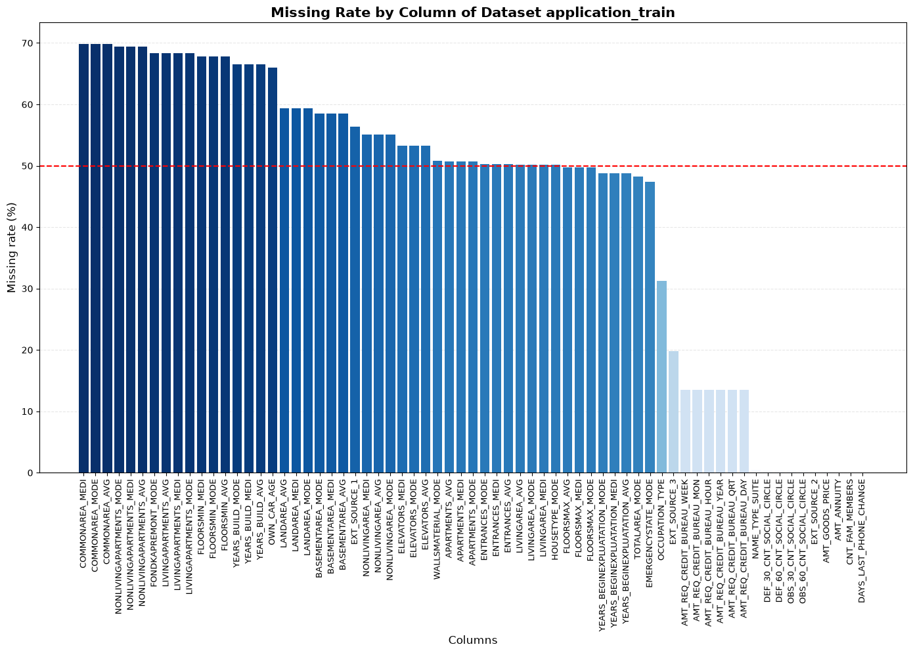 | 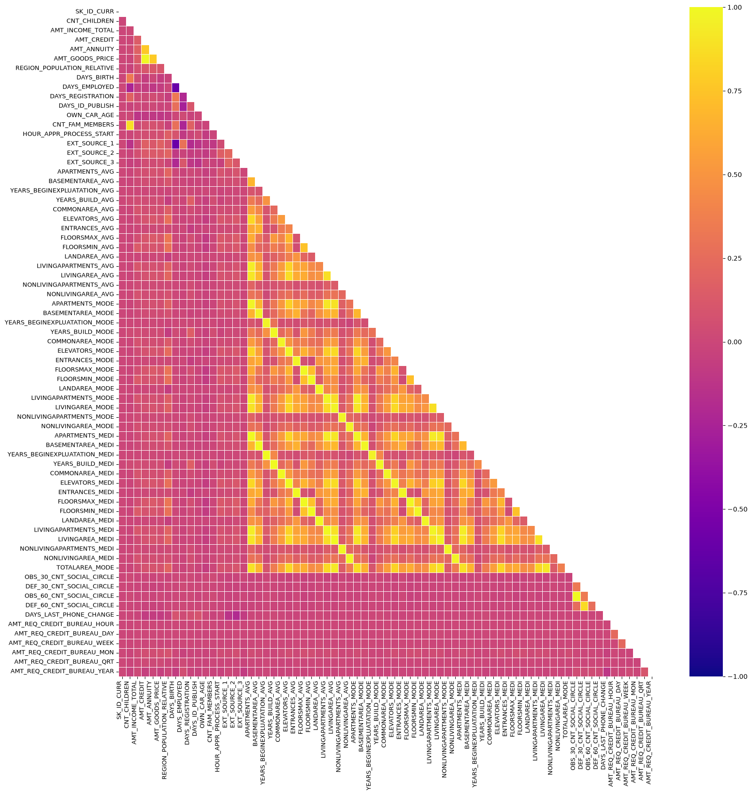 |

### 3.2. Demographics & Socioeconomic Risk Factors

- **Gender (`CODE_GENDER`)**: Male applicants exhibit a significantly higher default rate (**10.14%**) compared to female applicants (**6.99%**).
- **Education Level (`NAME_EDUCATION_TYPE`)**: Strong inverse relationship with default risk. Applicants with an Academic Degree or Higher Education have default rates of **1.8%** and **5.4%**, whereas Lower Secondary education shows a default rate of **10.9%**.
- **Occupation Profiling (`OCCUPATION_TYPE`)**: Low-skill Laborers have the highest default incidence (**17.15%**), followed by Drivers (**11.33%**) and General Laborers (**10.58%**). In contrast, Accountants (**4.83%**), High-Tech Staff (**6.10%**), and Managers (**6.23%**) present the lowest credit risk.
- **Family Status (`NAME_FAMILY_STATUS`)**: Single applicants (9.8%) and Civil Marriage applicants (10.0%) exhibit elevated default rates, whereas Married borrowers exhibit greater repayment stability (7.6%).
- **Address Discrepancies**: Applicants whose contact address differs from their registered permanent address (`REG_CITY_NOT_LIVE_CITY = 1`) show default rates exceeding **11.5%** (a strong proxy for residential/job instability).

| Education Level vs. Default Incidence | Occupation Type vs. Default Incidence |
| :---: | :---: |
| 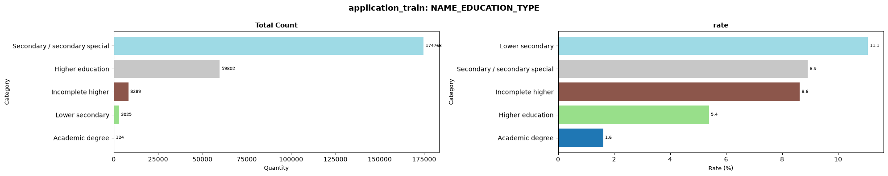 | 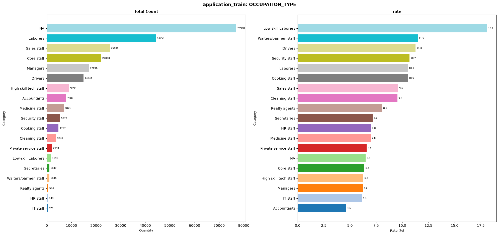 |

| Marital Status vs. Default Incidence | Contract Type (Cash vs. Revolving) vs. Default |
| :---: | :---: |
| 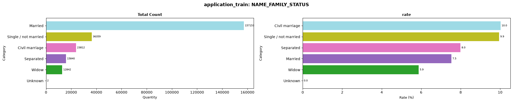 | 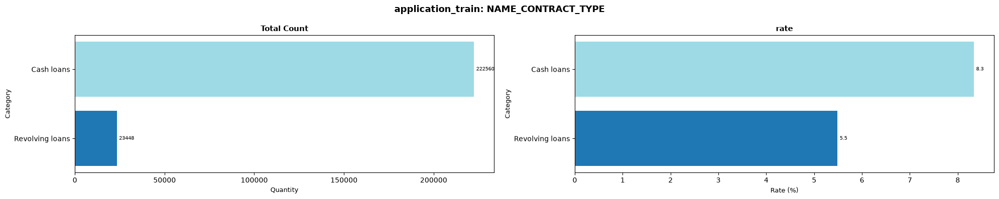 |

### 3.3. Temporal Dynamics & External Bureau Scores

- **Applicant Age (`DAYS_BIRTH`)**: Default risk peaks sharply at age 25–32 (default rates $>11\%$) and declines steadily with age, falling below $5.5\%$ for applicants aged 55 and older.
- **Employment Duration (`DAYS_EMPLOYED`)**: Short tenure at the current job strongly correlates with higher default rates among active workers.
- **External Risk Indicators (`EXT_SOURCE_1, 2, 3`)**: Normalized credit scores from three independent agencies represent the most powerful individual predictors. Defaulters display substantially depressed distributions across all three external metrics.

| Age Distribution: Default vs. Non-Default | External Score (EXT_SOURCE_1) Distribution |
| :---: | :---: |
| 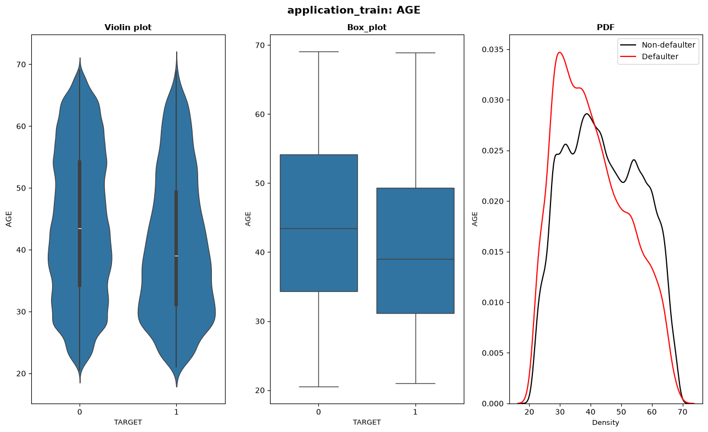 | 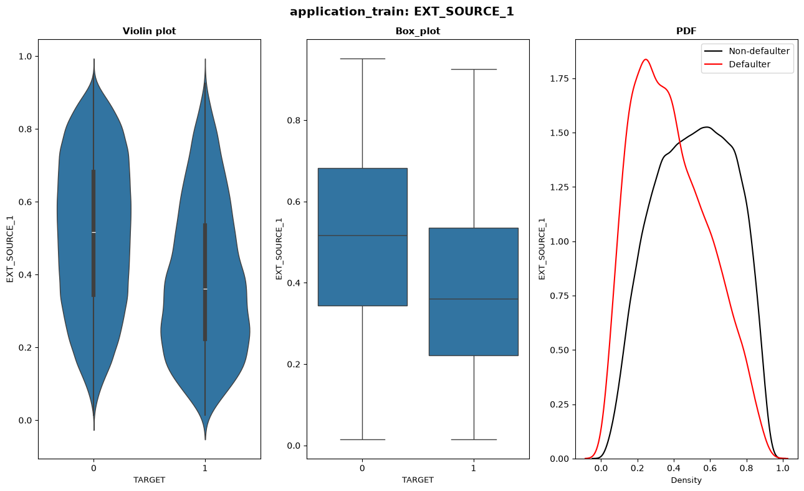 |

### 3.4. Credit Bureau Records (`bureau.csv` & `bureau_balance.csv`)

- **Credit Type (`CREDIT_TYPE`)**: Microloans from non-bank microfinance lenders carry default rates exceeding **20%**, identifying borrowers unable to access traditional bank credit lines.
- **Active vs. Closed Facilities (`CREDIT_ACTIVE`)**: Applicants carrying multiple open debt lines display higher delinquency risk than those with predominantly closed facilities.
- **Inquiry Recency (`DAYS_CREDIT`)**: Frequent recent credit inquiries at other institutions signal credit hunger and short-term liquidity strain.

| Bureau Credit Type vs. Default Risk | Association Matrix Among Bureau Features ($\Phi_K$) |
| :---: | :---: |
| 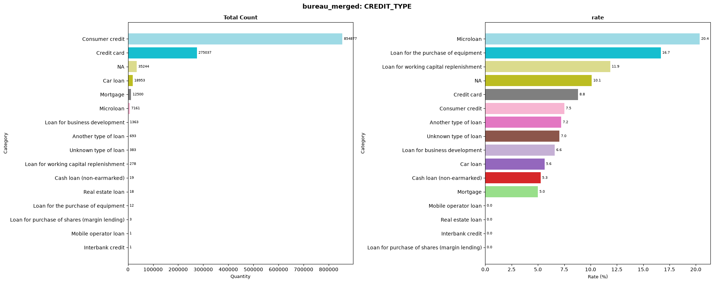 | 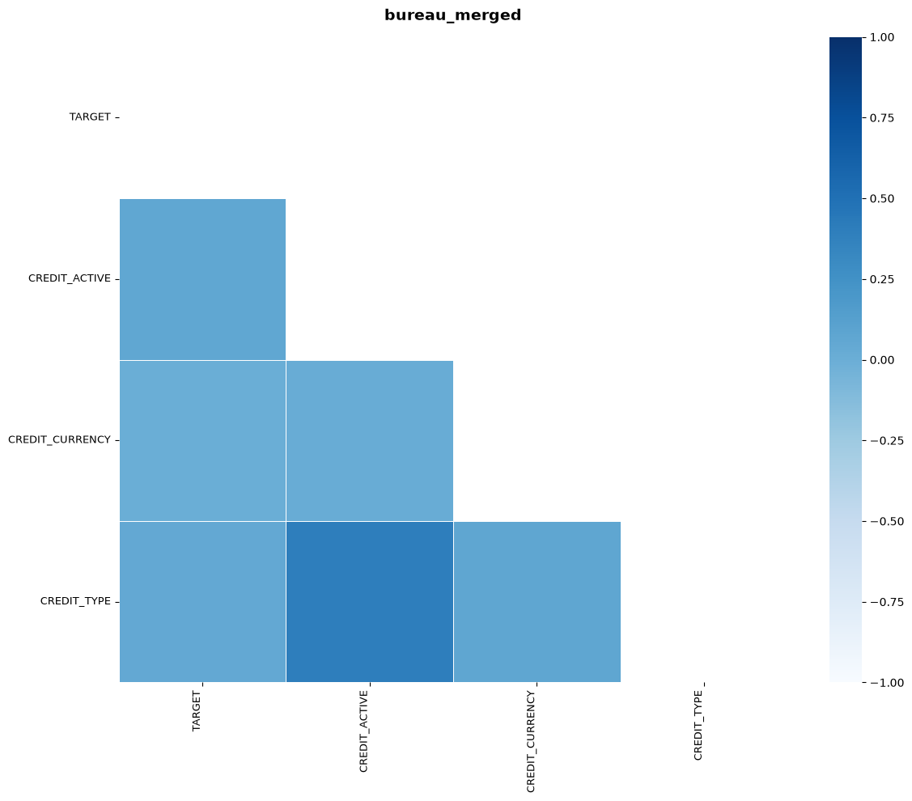 |

### 3.5. Previous Applications & Historical Repayment Behavior

- **Contract Decision History (`NAME_CONTRACT_STATUS`)**: A history of refused previous applications (`Refused`) is a strong risk indicator.
- **Rejection Reasons (`CODE_REJECT_REASON`)**: Applicants rejected due to internal credit limits (`HC`) exhibit high default risk upon re-application.
- **Installment Delinquencies (`installments_payments.csv`)**: Days Past Due (`DAYS_INSTALMENT - DAYS_ENTRY_PAYMENT < 0`) and payment deficits (`AMT_PAYMENT < AMT_INSTALMENT`) are the strongest operational indicators of default.

| Previous Application Decision Status vs. Default | Previous Contract Rejection Reason Breakdown |
| :---: | :---: |
| 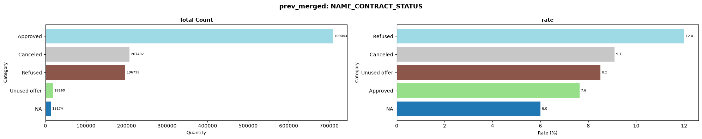 | 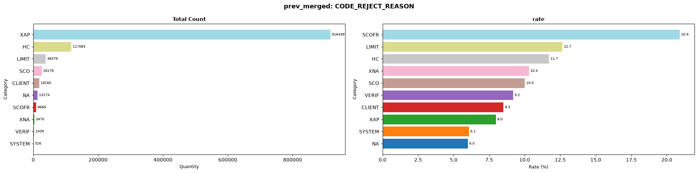 |

---

## 4. Feature Engineering & Selection Pipeline

The feature engineering modules under `srcs/data_preparation/` expanded the raw 122 application columns into a **1,440-feature master dataset**:

### 4.1. Predictive Imputation & Modeling
1. **Predictive Imputation of Missing `EXT_SOURCE`**: An `XGBRegressor` (`n_estimators=1000, max_depth=3, lr=0.1`) is trained on complete cases to impute missing values for `EXT_SOURCE_1`, `EXT_SOURCE_2`, and `EXT_SOURCE_3` using all numerical application features.
2. **Predictive Loan Term Estimation (`CNT_PAYMENT`)**: An `LGBMRegressor` (`n_estimators=5000, max_depth=9`) is trained on historical `previous_application` records (`AMT_CREDIT`, `AMT_ANNUITY`) to predict expected loan payment counts (`EXPECTED_CNT_PAYMENT`). This is used to derive:
   - `EXPECTED_INTEREST = AMT_ANNUITY * EXPECTED_CNT_PAYMENT`
   - `EXPECTED_INTEREST_SHARE = EXPECTED_INTEREST / AMT_CREDIT`
   - `EXPECTED_INTEREST_RATE = 24 * EXPECTED_INTEREST / (AMT_CREDIT * (EXPECTED_CNT_PAYMENT + 1))`

### 4.2. Financial Ratios & Interaction Features
- **Debt Service**: Debt-to-Income (`AMT_ANNUITY / AMT_INCOME_TOTAL`), Credit-to-Income, Goods-to-Income, Annuity-to-Credit.
- **External Score Interactions**: Arithmetic mean, variance, maximum, minimum, geometric product, and weighted combination:
  $$\text{WEIGHTED\_EXT} = 2 \times \text{EXT\_1} + 3 \times \text{EXT\_2} + 3 \times \text{EXT\_3}$$
- **Social Circle Default Pressure**: Ratios of defaulted contacts over total contacts in 30-day and 60-day observation windows (`SOCIAL_30_DEFAULT_RATE`, `SOCIAL_60_DEFAULT_RATE`).
- **Inquiry Velocity**: Recency intensity metrics over 1 day, 1 week, 1 month, 3 months, and 1 year.
- **Categorical Group Aggregations**: Groupings across high-dimensional segments (e.g., `[NAME_INCOME_TYPE, OCCUPATION_TYPE]`, `[OCCUPATION_TYPE, ORGANIZATION_TYPE]`) aggregating mean, max, and min for credit, income, and annuity.

### 4.3. Exponential Weighted Moving Average (EWMA) Across Historical Tables
To capture repayment trajectories and prioritize recent behavior over historical data, time-decay EWMA features are computed across all secondary transaction tables:
- **`bureau_balance`**: EWMA with $\alpha = 0.8$ on monthly overdue status (`STATUS`) and recency-weighted status (`STATUS / MONTHS_BALANCE`).
- **`installments_payments`**: EWMA with $\alpha = 0.5$ on payment delay ratios and installment underpayment amounts.
- **`POS_CASH_balance`**: EWMA with $\alpha = 0.65$ on completed installments and remaining terms.
- **`credit_card_balance`**: EWMA with $\alpha = 0.70$ on credit card balance, drawings, credit limit utilization (`AMT_BALANCE / AMT_CREDIT_LIMIT_ACTUAL`), and minimum payment coverage.

### 4.4. Feature Selection via `ImportanceFeatureSelector`
To avoid overfitting and reduce inference latency, `ImportanceFeatureSelector` (`srcs/data_preparation/feature_selection.py`) fits a LightGBM classifier on the 1,440-feature training set to rank feature importances:
- **Top 200 features** selected for **Logistic Regression** and **LightGBM**.
- **Top 400 features** selected for **XGBoost**.

---

## 5. Model Training & Hyperparameter Tuning

Hyperparameter optimization was conducted using Stratified 5-Fold Cross-Validation on the training partition (184,504 samples). Optimal configurations recorded in `config/model/best_params.yaml`:

| Parameter | Logistic Regression | LightGBM | XGBoost |
| :--- | :---: | :---: | :---: |
| **Selected Feature Count** | **200** | **200** | **400** |
| **Estimators (`n_estimators`)** | - | 500 | 500 |
| **Learning Rate** | - | 0.05 | 0.10 |
| **Max Depth** | - | -1 (unlimited) | 7 |
| **Leaves / Subsample** | - | `num_leaves: 63`, `subsample: 0.8` | `subsample: 1.0`, `colsample_bytree: 0.8` |
| **Regularization / Solver** | `penalty: l2`, `C: 1.0`, `solver: lbfgs` | - | $L_1$ and $L_2$ regularized |
| **5-Fold CV Mean ROC-AUC** | **0.8012** | **0.8525** | **0.8491** |
| **5-Fold CV Mean KS** | **46.20%** | **54.87%** | **54.12%** |

---

## 6. Cost-Sensitive Threshold Optimization

A cutoff of $\theta = 0.50$ is ineffective on an 8.07% default rate, yielding near-zero default recall. In credit underwriting, the loss matrix is asymmetric:

$$\text{Loss}(\text{False Negative}) \gg \text{Loss}(\text{False Positive})$$

- **False Negative (Default approved)**: Direct loss of unrecovered principal ($C_{FN}$).
- **False Positive (Good customer rejected)**: Opportunity loss of net interest margin ($C_{FP}$).

Using validation set analysis, 4 operating cutoffs were calibrated (`config/model/thresholds.yaml`):

| Operating Strategy | Cutoff ($\theta$) | Loss Assumption ($C_{FN} / C_{FP}$) | Default Recall | Precision | Operational Portfolio Context |
| :--- | :---: | :---: | :---: | :---: | :--- |
| **Youden's J Index** | **0.0401** | Maximize $(TPR - FPR)$ | **89.02%** | **17.12%** | Optimal statistical trade-off point |
| **Conservative (Risk-Averse)** | **0.0595** | $C_{FN} / C_{FP} = 10 : 1$ | 82.40% | 22.80% | Capital preservation during recessionary credit cycles |
| **Cost-Balanced** | **0.1090** | $C_{FN} / C_{FP} = 5 : 1$ | 68.75% | 31.40% | Profit-maximizing equilibrium under standard economic conditions |
| **Growth / Expansion** | **0.2476** | $C_{FN} / C_{FP} = 2 : 1$ | 42.10% | 45.20% | Market-share acquisition with risk-based loan pricing |

---

## 7. Independent Test Evaluation & Benchmark Findings

The models were evaluated on the **Holdout Test Set ($N = 61,501$)**, completely isolated until this final evaluation:

### 7.1. Benchmark Performance Metrics

| Metric Dimension | Metric Name | Logistic Regression (Scorecard) | LightGBM (Champion) | XGBoost |
| :--- | :--- | :---: | :---: | :---: |
| **Discrimination** | **ROC-AUC** | **0.8085** | **0.8556** | **0.8524** |
| | **Gini Coefficient ($2 \cdot \text{AUC} - 1$)** | **0.6171** | **0.7112** | **0.7048** |
| | **Kolmogorov-Smirnov (KS)** | **47.51%** | **56.25%** | **55.93%** |
| | **Average Precision (PR-AUC)** | 0.2957 | **0.3632** | 0.3492 |
| **Calibration** | **Brier Score** | 0.06455 | **0.06452** | 0.06508 |
| | **Expected Calibration Error (ECE)** | **0.00566** | 0.02046 | 0.02016 |
| **Stability** | **Population Stability Index (PSI)** | **0.0054** | **0.0233** | **0.0335** |
| **Operational Performance** | **Evaluation Threshold ($\theta$)** | 0.0383 | 0.0401 | 0.0527 |
| | **Recall (Default Capture)** | 88.42% | **89.02%** | 86.20% |
| | **Precision** | 13.80% | **17.12%** | **18.42%** |
| | **F1-Score** | 0.2388 | **0.2872** | **0.3035** |
| | **Balanced Accuracy** | 69.96% | **75.59%** | **76.33%** |
| **Confusion Matrix** | True Positives ($TP$) | 4,390 | **4,420** | 4,280 |
| | False Negatives ($FN$, Missed Defaults) | 575 | **545** | 685 |
| | True Negatives ($TN$) | 29,121 | 35,143 | **37,577** |
| | False Positives ($FP$) | 27,415 | 21,393 | **18,959** |

### 7.2. Model Discrimination & Reliability Curves

| Receiver Operating Characteristic (ROC Curve) | Kolmogorov-Smirnov Separation (KS Curve) |
| :---: | :---: |
| 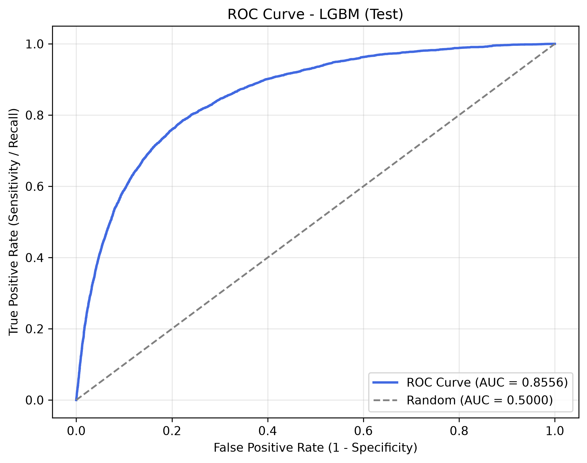 | 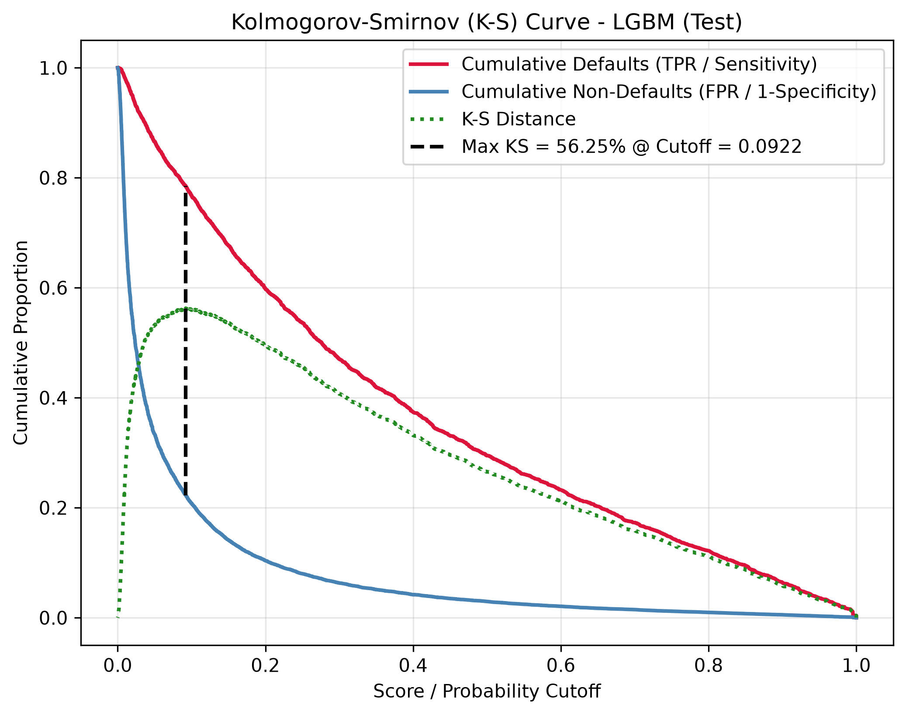 |

| Probability Calibration Reliability Curve | Precision-Recall (PR Curve) |
| :---: | :---: |
| 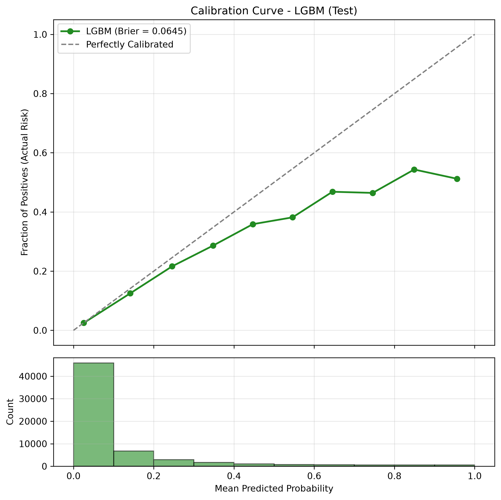 | 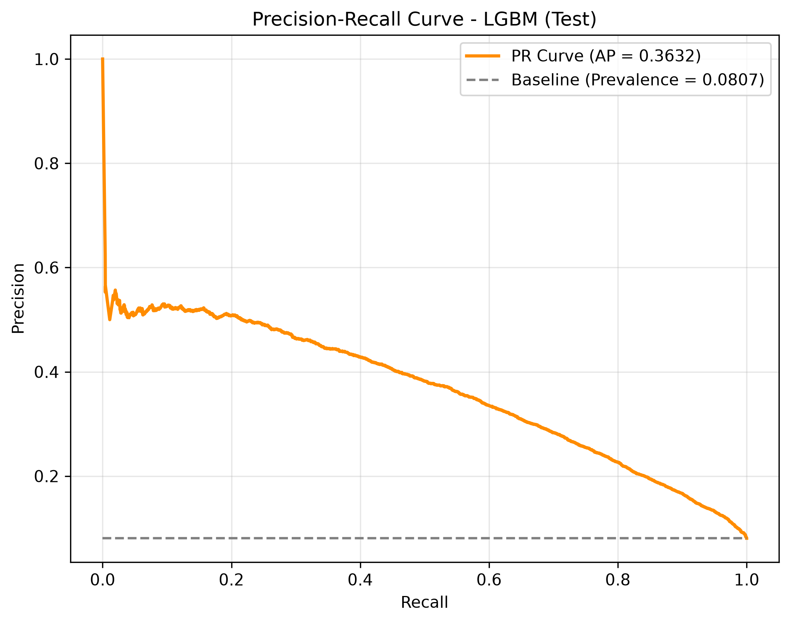 |

---

## 8. FICO Credit Scorecard & Business Implementation

### 8.1. Scorecard Scaling Transformation

The continuous probability $p$ is scaled to an industry-standard credit scorecard:

$$\text{Score} = \text{Offset} - \text{Factor} \times \ln\left(\frac{p}{1 - p}\right)$$

Parameters: **Base Score = 600**, **Base Odds = 50:1**, **PDO = 20**:

$$\text{Factor} = \frac{20}{\ln(2)} \approx 28.8539, \quad \text{Offset} = 600 - 28.8539 \times \ln(50) \approx 487.1229$$

The linear formulation maps each standardized feature directly to integer scorecard points (`reports/model/lr_scorecard_points_table.csv`).

### 8.2. Rating Tiers & Monotonicity Verification

The test population is mapped into 5 operational rating tiers:

| Rating Tier | FICO Score Range | Account Count | Portfolio Share | Empirical Default Rate | Credit Policy Decision |
| :---: | :---: | :---: | :---: | :---: | :--- |
| **Tier A (Prime)** | $\ge 750$ | 794 | 1.29% | **0.94%** | Automated approval, lowest interest rate, maximum credit limit |
| **Tier B (Near-Prime)** | 700 – 749 | 2,752 | 4.47% | **1.71%** | Automated approval, standard pricing |
| **Tier C (Core)** | 640 – 699 | 8,970 | 14.58% | **3.01%** | Standard approval, moderate credit limit |
| **Tier D (Subprime)** | 580 – 639 | 20,447 | 33.25% | **5.40%** | Manual review, proof of income required, reduced limit |
| **Tier E (Deep Subprime)** | $< 580$ | 28,539 | 46.40% | **12.44%** | **Automatic Rejection (Cutoff)** |

> **Monotonicity**: The observed default rate drops monotonically from **12.44%** in Tier E to **0.94%** in Tier A, confirming the score ordering holds across risk bands.


### 8.3. Adverse Action Notice (Automated Reject Reason)

For applicant `#240757`, who received a score of **518 points** (Tier E, estimated default probability **25.69%**), the system automatically extracts the top 5 score-reducing factors:

| Rank | Adverse Driver Feature | Observed Value | Point Penalty | Banking Rationale |
| :---: | :--- | :---: | :---: | :--- |
| **1** | `EXT_SOURCE_2` | 0.141 (Depressed) | **-32.4 pts** | External agency score indicates poor credit profile |
| **2** | `EXT_SOURCE_3` | 0.089 (Depressed) | **-26.8 pts** | Secondary bureau rating indicates recent negative events |
| **3** | `BUREAU_DAYS_CREDIT_UPDATE_MEAN` | Highly Recent | **-18.7 pts** | Recent credit line updates at other institutions |
| **4** | `ANNUITY_INCOME_RATIO` | 0.385 (High) | **-14.2 pts** | Annuity obligation consumes 38.5% of total income |
| **5** | `DAYS_BIRTH` | -8,120 days | **-11.5 pts** | Applicant age under 23 correlates with high repayment volatility |

---

## 9. Machine Learning Explainability (SHAP TreeExplainer)

Using `shap.TreeExplainer` on LightGBM across a 2,000-sample validation cohort (`notebook/model/explainability.ipynb`):

### 9.1. Global Summary & Feature Importance

| SHAP Summary Beeswarm Plot | SHAP Mean Absolute Importance |
| :---: | :---: |
|  |  |

**Top Risk Drivers & Impact Directionality** (`reports/model/lgbm_top_risk_drivers.csv`):
1. `EXT_SOURCE_1, 2, 3`: Strong negative association (high score $\implies$ significant risk reduction).
2. `DAYS_BIRTH`: Negative association (higher age $\implies$ lower default risk).
3. `DAYS_EMPLOYED`: Negative association (longer tenure $\implies$ higher employment stability).
4. `AMT_ANNUITY`: Positive association (higher installment burden $\implies$ increased default risk).
5. `DAYS_ID_PUBLISH`: Negative association (older identity documents $\implies$ higher stability).

### 9.2. Local Applicant Explainability (SHAP Waterfall Plots)

- **Defaulted Applicant (High Risk)**: Positive SHAP contributions (red bars) drive the score above the base value $E[f(X)]$, driven by low external bureau scores and high debt-to-income ratios.
- **Approved Applicant (Low Risk)**: Negative SHAP contributions (blue bars) lower the risk score, driven by high external bureau ratings and stable employment tenure.

---

## 10. Software Architecture & CLI Usage

### 10.1. Repository Layout

```
credit-risk-modelling/
├── config/                                 # Declarative configuration files
│   ├── path.yaml                           # Directory and file path definitions
│   ├── data_quality/                       # Table-specific data quality rule sets
│   └── model/                              # Hyperparameters, search spaces, and cutoffs
│       ├── best_params.yaml                # Optimal hyperparameters from 5-fold CV
│       ├── thresholds.yaml                 # Calibrated decision thresholds
│       └── tuning_space.yaml               # Hyperparameter search boundaries
│
├── srcs/                                   # Production source code
│   ├── data_quality/                       # DQA validation classes
│   ├── data_preparation/                   # Feature engineering & predictive imputation
│   │   ├── application.py, bureau_bureau_balance.py, previous_application.py
│   │   ├── installments_payments.py, credit_card_balance.py, pos_cash_balance.py
│   │   ├── feature_builder.py, feature_selection.py, merge_main_table.py
│   ├── pipelines/                          # Execution pipelines
│   │   ├── core/                           # Config loaders, model factories, scoring utils
│   │   ├── plots/                          # Standalone evaluation & CV plotting modules
│   │   ├── reporting/                      # JSON/YAML report aggregators
│   │   ├── pipeline.py                     # PipelineRunner orchestrator
│   │   └── runner.py                       # CLI execution entry point
│   └── evaluation/                         # Evaluation and interpretability modules
│       ├── discrimination.py               # AUC, Gini, KS, PR metrics
│       ├── calibration.py                  # Brier score, ECE, calibration curves
│       ├── stability.py                    # Population Stability Index (PSI)
│       ├── scorecard.py                    # ScorecardScaler class (FICO scaling)
│       └── shap_analysis.py                # SHAP TreeExplainer analysis wrapper
│
├── notebook/                               # Analytical workbooks
│   ├── data_understanding/                 # EDA and Data Quality notebooks
│   │   ├── data_quality.ipynb, EDA.ipynb, target_analysis.ipynb
│   └── model/                              # Modeling and explainability notebooks
│       ├── preparation.ipynb               # Feature engineering execution
│       ├── model.ipynb                     # Training and cross-validation execution
│       └── explainability.ipynb            # FICO Scorecard & SHAP explainability workbook
│
├── reports/model/                          # Evaluation outputs and generated scorecards
│   ├── lgbm_test_report.json, lr_test_report.json, xgb_test_report.json
│   ├── lr_scorecard_points_table.csv       # Point allocations for 200 scorecard features
│   └── lr_scorecard_rating_bands.csv       # Five-tier rating band distributions
│
├── Images/                                 # Visual artifacts
│   ├── EDA/                                # 55 exploratory analysis charts
│   ├── Model/                              # Model benchmark curves (ROC, KS, PR, Calibration)
│   └── Explainable AI/                     # SHAP plots and scorecard score distributions
│
├── tests/                                  # Automated test suite (10 unit/integration tests)
│   └── test_pipeline.py
├── pytest.ini                              # Pytest runner settings
└── README.md                               # Project documentation
```

### 10.2. Environment Provisioning & Installation

```bash
# Initialize dedicated virtual environment
conda create -n credit-risk python=3.11 -y
conda activate credit-risk

# Install dependencies from requirements.txt
pip install -r requirements.txt
```

### 10.3. Execution via CLI

```bash
# 1. Run 5-Fold Cross Validation with hyperparameter tuning
python srcs/pipelines/runner.py --mode cv --model lgbm --n_trials 20

# 2. Train on Train split and calibrate on Validation split
python srcs/pipelines/runner.py --mode valid --model lgbm

# 3. Evaluate on Holdout Test partition and generate test curves
python srcs/pipelines/runner.py --mode test --model lgbm

# 4. Run automated test suite
pytest tests/ -v
```

---

## 11. Methodological Limitations & Future Work

1. **Macroeconomic Sensitivity**: The dataset captures a cross-sectional timeframe without macroeconomic variables (e.g., policy interest rates, inflation, unemployment). Future iterations will incorporate through-the-cycle (TTC) stress testing.
2. **Reject Inference**: The training data includes only historically approved loans, introducing sample selection bias. Implementing fuzzy parceling or Heckman two-stage correction would help model the unobserved repayment behavior of rejected applicants.
3. **Behavioral Early Warning System (EWS)**: Extending this origination scoring model into recurring monthly behavioral scoring for active credit card and revolving loan portfolio monitoring.

---

## License

Distributed under the **MIT License**.
